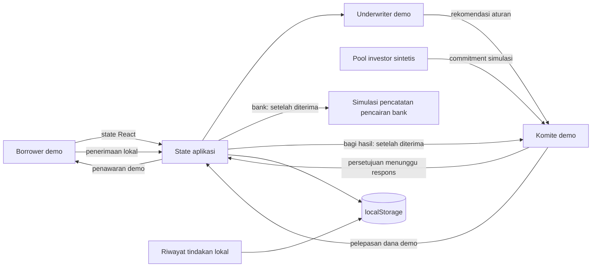

# Arsitektur yang Ada — CreditPulse / CrediVault

> **Status: frontend demo, bukan rancangan produksi.** Semua profil debitur, mutasi, parameter, investor, status verifikasi, dan metrik memakai data sintetis atau asumsi simulasi.

## Ringkasan

Project ini adalah satu aplikasi React/Vite yang menyimpan state aplikasi di browser. Tidak ada backend, layanan identitas, database, penyimpanan dokumen, konektor SLIK/e-KYC, payment rail, atau audit service. Pemilih peran hanya mengubah layar yang ditampilkan.

Demo mempertahankan dua skenario portofolio untuk presentasi:

- **Skenario bank/BPRS:** profil neraca dan simulasi likuiditas bank.
- **Skenario pendanaan investor/P2P:** alokasi commitment sintetis ke aplikasi.

Keduanya belum mewakili entitas berizin dan tidak boleh diperlakukan sebagai satu alur pencairan nyata.

## Alur UI saat ini



## Modul dan implementasi

| Modul | Implementasi saat ini | Batas yang harus terlihat di UI |
|---|---|---|
| Borrower | Form dan simulator di `src/components/BorrowerPortal.tsx` | Data mutasi/neraca untuk draft dibangkitkan dari input; tidak ada upload atau validasi dokumen nyata. |
| Underwriter | Perhitungan di `src/engine/creditEngine.ts` dan portal analis | Skor deterministik berbasis aturan buatan tangan; bukan model ML terlatih, PD terkalibrasi, atau rekomendasi final. |
| Komite | Daftar, batch decision, komitmen investor, pelepasan dana P2P demo, dan riwayat lokal | Keputusan hanya status demo; tidak membentuk kontrak, escrow, atau transfer dana. |
| Treasury | Rumus sintetis dan pencatatan pencairan bank demo di `src/components/BankTreasuryPortal.tsx` dan engine | Rasio memakai input dan asumsi sederhana; tidak menjadi indikator kepatuhan OJK/BI atau laporan bank. |
| Admin | Policy, profile, dan daftar anggota pada state UI | Bukan autentikasi, otorisasi, atau kontrol admin server. |

## Interpretasi angka demo

- **Skor dan indikator risiko:** hasil aturan tetap untuk menunjukkan alur penilaian. Belum ada target default, data historis, validasi, kalibrasi, pemantauan drift, atau governance model.
- **Kontribusi faktor:** dampak aturan per faktor; bukan nilai SHAP.
- **Eksposur yang diminta:** nilai permohonan. Ini belum merupakan EAD kontraktual.
- **Proxy kerugian:** perkalian sinyal risiko, proxy LGD, dan nilai permohonan. Ini bukan CKPN/ECL akuntansi.
- **DSCR demo:** arus kas tersedia setelah biaya usaha dan rumah tangga dibagi total kewajiban bulanan yang sudah ada ditambah angsuran baru.
- **Beban utang/omzet:** total kewajiban bulanan dibagi omzet bulanan. Ini adalah rasio sederhana khusus demo; batasnya dapat diubah dan bukan standar kebijakan universal.
- **Bank health:** CAR/FDR/NPL/ATMR, biaya dana, batas konsentrasi, dan stres memakai asumsi sederhana untuk visualisasi, bukan rulebook regulator.
- **Mudharabah/Musyarakah:** belum ada jadwal atau proyeksi arus kas bagi hasil. DSCR/rasio beban utang ditandai belum dihitung dan hasil underwriting dipaksa ke tinjauan manual.

## State dan penyimpanan

`src/App.tsx` menjadi pemilik state global dan menaruh aplikasi serta riwayat lokal di `localStorage`. Browser dapat mengubah atau menghapus data ini; state tidak dibagi antar pengguna/perangkat. Belum ada migrasi skema, transaksi atomik, validasi backend, identitas aktor, retensi, atau bukti audit yang tahan perubahan.

## Struktur kode

```text
src/
  App.tsx                         # State dan navigasi demo
  types/credit.ts                 # Tipe aplikasi, policy, dan evaluasi demo
  engine/creditEngine.ts          # Simulator angsuran, aturan risiko, rasio, dan metrik bank
  data/demoApplications.ts        # Aplikasi, investor, dan riwayat sintetis
  components/
    BorrowerPortal.tsx
    UnderwriterPortal.tsx
    CommitteePortal.tsx
    BankTreasuryPortal.tsx
    AdminSettingsPortal.tsx
    AdminCharts.tsx
    OfficialDocumentModal.tsx
```

Untuk urutan perubahan dan fitur demo berikutnya, lihat [ROADMAP.md](./ROADMAP.md).
